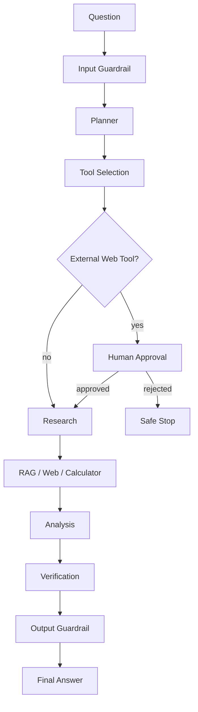
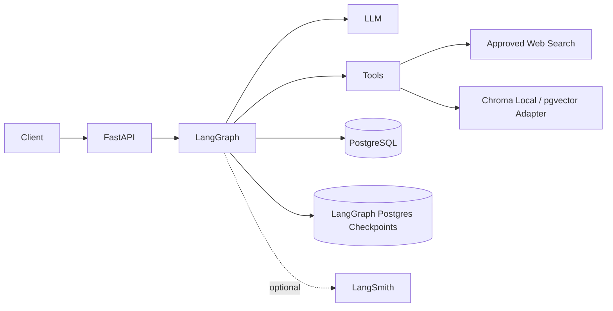
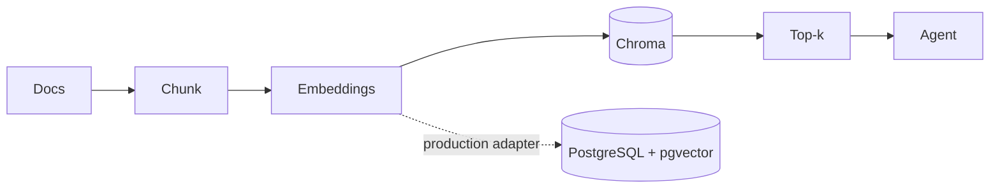
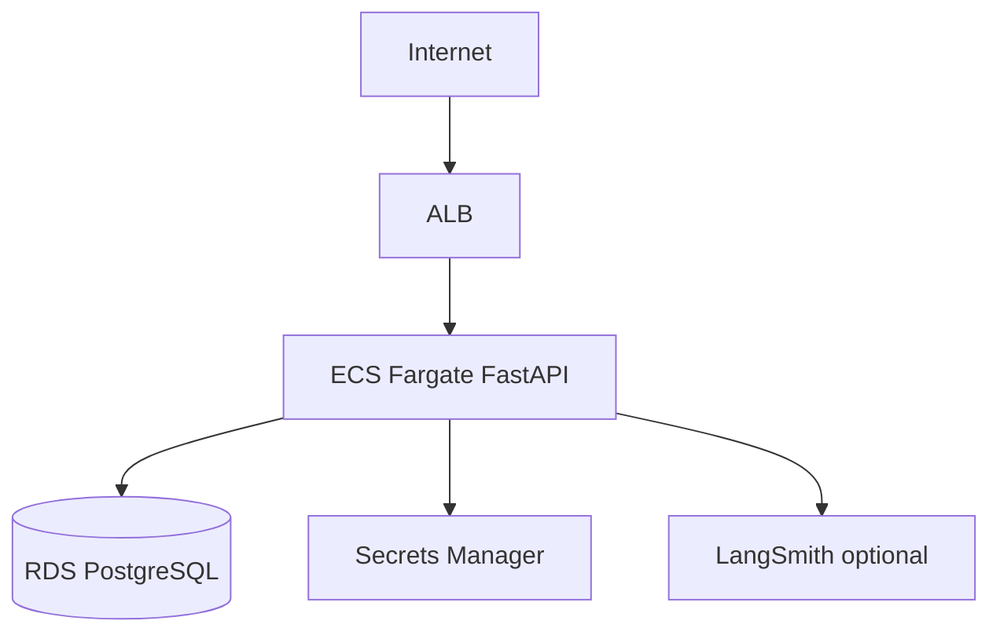

# Enterprise Research & Decision Agent

Production-oriented portfolio project demonstrating LangGraph agent orchestration, typed tool calling, RAG, guardrails, human approval, persistent state, FastAPI, PostgreSQL, Docker, testing, evaluation, LangSmith compatibility, and an AWS deployment path.

## Workflow


## System architecture


## RAG


## Deployment


## Structure
```text
app/
  api/          FastAPI routes + demo
  agents/       LLM/embedding factory
  config/       environment configuration
  database/     SQLAlchemy models/session
  graph/        LangGraph state, nodes, builder, checkpoint
  guardrails/   input/output/tool policies
  models/       Pydantic API schemas
  rag/          Chroma and pgvector adapters
  services/     auth, persistence, tracing
tools/          web search, retrieval, calculator, verification
evals/          30-question dataset + runner
tests/          pytest suite
docs/           architecture + AWS deployment
```

## Local setup
```bash
python -m venv .venv
# Windows PowerShell
.venv\\Scripts\\Activate.ps1
# macOS/Linux: source .venv/bin/activate
pip install -r requirements.txt
copy .env.example .env
```

Set `GOOGLE_API_KEY`, a long `JWT_SECRET_KEY`, and PostgreSQL settings in `.env`. Google Gemini is the default provider in this distribution, so an OpenAI key is not required. Create a Gemini API key in [Google AI Studio](https://aistudio.google.com/apikey). The free tier has limits; check current quota/pricing before use and do not send confidential data to a free-tier provider. Set `LLM_PROVIDER=openai` only if you have configured an OpenAI API key.

The Google provider uses `GOOGLE_MODEL` for chat and `GOOGLE_EMBEDDING_MODEL` for embeddings. If you change embedding providers after documents have already been indexed, clear/recreate the Chroma collection and re-ingest the documents because vector dimensions may differ.

### Docker
```bash
docker compose up --build
```

API: `http://localhost:8000`  
Swagger: `http://localhost:8000/docs`  
Demo: `http://localhost:8000/demo`

### Database migrations
```bash
alembic upgrade head
```

### RAG ingestion
```bash
python -m app.rag.ingest
```

## API
Create a bearer token:
```bash
curl -X POST http://localhost:8000/api/v1/auth/token -H "Content-Type: application/x-www-form-urlencoded" -d "username=demo&password=change-me"
```

Start research:
```bash
curl -X POST http://localhost:8000/api/v1/research \
 -H "Authorization: Bearer <TOKEN>" -H "Content-Type: application/json" \
 -d '{"question":"Compare synthetic data generation approaches for healthcare AI development.","top_k":5}'
```

If web research is selected, the graph interrupts and returns `awaiting_approval`. Resume it:
```bash
curl -X POST http://localhost:8000/api/v1/approval \
 -H "Authorization: Bearer <TOKEN>" -H "Content-Type: application/json" \
 -d '{"conversation_id":"<ID>","approved":true}'
```

Check status:
```bash
curl http://localhost:8000/api/v1/research/<ID> -H "Authorization: Bearer <TOKEN>"
```

## Tools
1. `web_search` — allow-listed public domains only.
2. `document_retrieval` — semantic search over Chroma.
3. `calculator` — restricted arithmetic AST; no Python execution.
4. `source_verification` — fetches a URL and performs a transparent heuristic support check.

Tool selection is state-driven, and tool names/arguments are validated before execution.

## Persistence
Application execution records use SQLAlchemy/PostgreSQL. LangGraph uses `PostgresSaver` during normal application startup, including checkpoint setup, so the graph can resume by `thread_id`. The builder's `MemorySaver` fallback is deliberately only for isolated environments where PostgreSQL is unavailable.

## Guardrails
Input: length limits, prompt-injection patterns, unsupported execution requests.  
Tool: allow-list + Pydantic schemas + no arbitrary code execution.  
Output: citation, grounding, and secret-disclosure checks.

## LangSmith
Set:
```env
LANGSMITH_TRACING=true
LANGSMITH_API_KEY=...
LANGSMITH_PROJECT=enterprise-research-agent
```
The application still runs with tracing disabled.

Compatibility with the original specification is also supported through `LANGCHAIN_TRACING_V2`, `LANGCHAIN_API_KEY`, and `LANGCHAIN_PROJECT`.

## Evaluation
The dataset contains 30 realistic questions:
```bash
python -m evals.run_evaluation
```
The runner writes `evaluation_results/latest.json`. It reports explicit proxy metrics and does **not** fabricate benchmark scores. For formal Ragas/LangSmith metrics, run the same dataset through the configured evaluation service and retain the generated report.

## Tests
```bash
pytest -q
pytest --cov=app --cov-report=term-missing
```

## AWS
See `docs/aws-deployment.md`. Target architecture: ECR → ECS/Fargate → RDS PostgreSQL/pgvector → ALB, with Secrets Manager for secrets. The deployment is not claimed as completed until you actually deploy and verify it.

## Security limitations
This portfolio implementation uses a demo username/password and JWT secret from environment variables. A real multi-tenant product should use an external identity provider, managed secrets, network isolation, stronger authorization, and security testing. No SOC 2/ISO/compliance claim is made.

